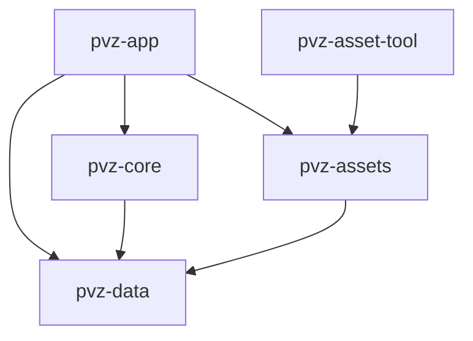

# 模块与依赖

本目录维护实际模块合同及依赖方向；五个 package 均已注册，成员和第三方依赖以根 [Cargo.toml](../../Cargo.toml) 为准。首个开发切片与现有白天内容数据化已通过本地实现验收，证据见 [版本化内容结果](../behavior/content-foundation-results.md)，历史计划见 [版本化白天内容计划](../superpowers/plans/2026-10-12-versioned-day-content.md)。当前总计划是[最小可玩垂直切片](../superpowers/plans/2026-10-13-minimum-playable-vertical-slices.md)，原版证据计划是[行为基线测量](../superpowers/plans/2026-10-12-reference-behavior-measurement.md)。长期边界见 [游戏开发原则](../principles/game-development.md)。

## 依赖方向

箭头表示 workspace 内部的直接依赖。data、core、assets 没有引擎依赖；core 与 assets 不互相依赖。平台字节加载与媒体解码在 app，宿主目录审计在 assets/tool，data 与 core 不做文件 I/O。tool 是宿主 CLI，不加入 WASM 应用依赖图。

## crate 职责

| crate | 当前能力 | 后续方向 | 职责边界 |
| --- | --- | --- | --- |
| [pvz-data](../../crates/pvz-data/README.md) | 强类型 ID、schema/规则版本、参考基线 ID、严格白天内容 DTO 与序列化合同 | 完整内容数据 schema | 不做 I/O、规则执行、引擎与设备操作 |
| [pvz-core](../../crates/pvz-core/README.md) | 空棋盘 1.0、开发切片 2.0 的规则/实体/碰撞、RNG、命令/事件、完整摘要与白天 DTO 纯装配 | 按参考证据扩展规则和持久回放 | 不依赖 JSON 生产解析、资源、平台、引擎或墙钟 |
| [pvz-assets](../../crates/pvz-assets/README.md) | JSON 清单审计、资源索引、Reanim/粒子 XML 子集、CPU 模型与诊断 | 按需求扩展受支持格式 | 不决定伤害/波次，不持有 GPU 句柄 |
| [pvz-app](../../crates/pvz-app/README.md) | 原创 JSON 解析装配、实际频率消费、窗口、输入、native/Web 资源装配、向日葵动态 idle、普通僵尸开发 walk 与其余静态构图、切片 UI、事件音效与探针 | 完整动画/粒子、存档、生命周期及移动入口 | 消费 core 状态/事件，不复制规则 |
| [pvz-asset-tool](../../tools/pvz-asset-tool/README.md) | `audit` 与 `inspect-reanim`，只读检查登记资源 | 有实际需求时引入转换/打包 | 不运行原版或修改来源资源/core 规则 |

## 数据流

 [原创关卡 JSON](../../content/levels/development-day.json)编译时嵌入 app → 大小检查与 serde_json 严格解析 → data DTO → core 支持版本/频率检查、字段转换与既有规则校验 → 带初始时钟的状态 → Runtime 读取实际频率推进。默认内容保持 `development` 依据；native/Web 使用同一输入字节，无文件加载器或静默回退。正常入口的 `F` 键只切换到同样装配链上的明确 `development-failure.json`，不引入通用选关层。probe 独立使用空棋盘，旧开发工厂保留为迁移对照及测试/基准消费者。完整格式与恢复合同见[内容设计](../superpowers/specs/2026-10-12-versioned-day-content.md)。

平台有序窗口事件 → 物理/逻辑坐标映射 → 有序游戏命令 → core 更新 → 状态/事件 → UI、构图与音频。切片暂停、重开和终局可以不推进 tick，具体见 [开发切片合同](../behavior/development-slice.md)。声音与表现消费事件，不反向决定伤害。

宿主文件或浏览器字节 → 清单/指纹校验与 assets 解析 → app 媒体解码、CPU 模型与引擎资源 → 绘制和音频。`main.pak` 保留为参考来源包，当前运行时直接加载登记的解包文件。core 测试直接提交命令，无需窗口、资源包或系统路径。

## pvz-app 内部模块

| 模块 | 当前职责 |
| --- | --- |
| `viewport`、`input`、`platform_input` | 纯坐标变换、指针状态及按窗口事件顺序处理键盘、指针、尺寸/DPI/取消 |
| `content` | 编译嵌入默认 JSON、输入字节上限与中文错误分类/原因链 |
| `runtime` | JSON 解析及纯核心装配、实际模拟频率与表现时钟接线、逻辑输入到 core 命令及 UI/事件适配 |
| `resources` | native/Web 字节加载、清单验证、媒体解码、显式图像映射及 SunflowerIdle/ZombieWalk 单次装配 |
| `animation`、`geometry` | 纯动画准备/采样、双轴仿射与 UV 裁剪合同 |
| `render` | Bevy 网格/纹理、动态 idle/walk 借用采样、其余静态实体构图和中文 UI |
| `audio` | 媒体支持检查与事件音效映射；MO3 明确未支持 |
| `main` | 窗口/调度装配、平台事件、资源加载状态、播放游标与后台冒烟 |
| `screenshot_wait` | native binary 私有的截图等待上限与一次性结果，由后台冒烟实际消费 |

完整动画播放器、原版粒子、存档和移动生命周期属于后续工作，不以不存在的模块名表示已经接入。独立 crate 的拆分依据稳定接口、实际消费者或独立测试需要，不为未来设想预建空 package/API。

向日葵资源由 `LoadedResources` 一次解析、严格映射和解码，装配一个 `SunflowerIdle` 缓存后移动到 `Scene`；`Scene::update` 借用采样帧，接收应用在 `Runtime::advance` 后提供的 `animation_seconds`，复用图像、网格与材质池。全局相位、离散采样、暂停/双终局冻结和重开清零属于本项目开发合同；独立实体相位、插值和原版动作语义尚未接受。表现只消费核心状态，动画不决定产阳光、伤害、死亡或胜负。native 冒烟截图等待期间冻结 Runtime/Scene，Bevy 渲染与真实等待时钟继续推进，30 秒超时仍返回错误退出。

普通僵尸完整 clip 同样只解析/prepare 一次，严格映射全部引用、去重解码；`LoadedResources.zombie_walk` 移入唯一 `Scene.zombie_walk`，旧 Zombie 静态 pose 已移除，静态键只剩 Peashooter/Pea/Sun/LawnMower。`ZombieWalk` 在资源 `anim_walk` 半开段 `44..91`、12fps 中借用 19 条身体源轨道，Scene 保留源索引深度、各 actor 当前 row/x 与已有池。全局相位使新出生僵尸接当前相位，碰到植物仍持续 walk；啃食/死亡可靠输入与事件合同归 B2，尚未实施。B1 维护后的源码已完成工程检查、native/WASM 构建与绑定及 CLI 冒烟，并纳入维护提交；Windows 正常窗口缺项、Web 诊断和平台最终复核继续待完成，Git/CI 记录见[维护结果](../behavior/content-foundation-results.md#2026-10-15-全仓审计与维护阶段性收尾)，见[本批结果](../behavior/content-foundation-results.md#2026-10-14-普通僵尸动态行走增量)。
