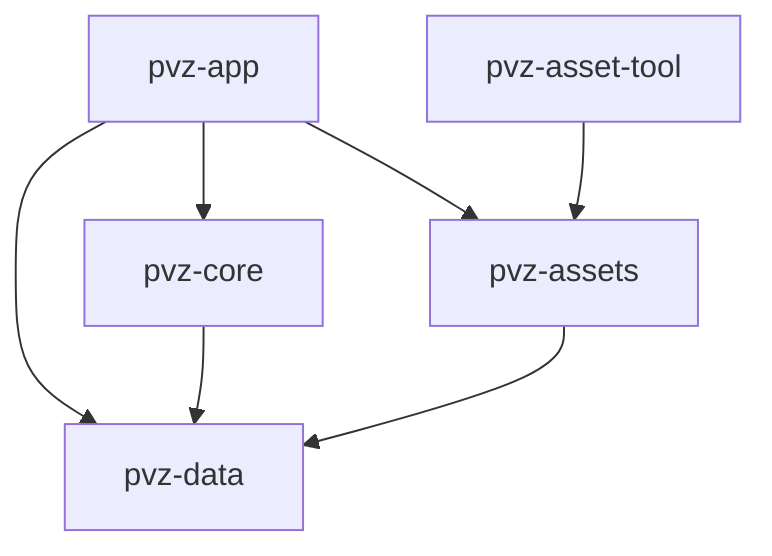

# 模块与依赖

本目录维护实际模块合同及依赖方向；五个 package 均已注册，成员和第三方依赖以根 [Cargo.toml](../../Cargo.toml) 为准。首个开发切片已完成工程验收，当前推进内容数据化，进度见 [实施计划](../superpowers/plans/2026-10-12-versioned-day-content.md)。长期边界见 [游戏开发原则](../principles/game-development.md)。

## 依赖方向

箭头表示 workspace 内部的直接依赖。data、core、assets 没有引擎依赖；core 与 assets 不互相依赖。平台字节加载与媒体解码在 app，宿主目录审计在 assets/tool，data 与 core 不做文件 I/O。tool 是宿主 CLI，不加入 WASM 应用依赖图。

## crate 职责

| crate | 当前能力 | 后续方向 | 职责边界 |
| --- | --- | --- | --- |
| pvz-data | 强类型 ID、schema/规则版本、参考基线 ID、序列化合同 | 完整内容数据 schema | 不做 I/O、引擎与设备操作 |
| pvz-core | 空棋盘 1.0、开发切片 2.0 的规则/实体/碰撞、RNG、命令/事件与完整摘要 | 按参考证据扩展规则和持久回放 | 不依赖资源、平台、引擎或墙钟 |
| pvz-assets | JSON 清单审计、资源索引、Reanim/粒子 XML 子集、CPU 模型与诊断 | 按需求扩展受支持格式 | 不决定伤害/波次，不持有 GPU 句柄 |
| pvz-app | 窗口、输入、native/Web 资源装配、静态构图、切片 UI、事件音效与探针 | 完整动画/粒子、存档、生命周期及移动入口 | 消费 core 状态/事件，不复制规则 |
| pvz-asset-tool | `audit` 与 `inspect-reanim`，只读检查登记资源 | 有实际需求时引入转换/打包 | 不运行原版或修改来源资源/core 规则 |

## 数据流

平台有序窗口事件 → 物理/逻辑坐标映射 → 有序游戏命令 → core 更新 → 状态/事件 → UI、构图与音频。切片暂停、重开和终局可以不推进 tick，具体见 [开发切片合同](../behavior/development-slice.md)。声音与表现消费事件，不反向决定伤害。

宿主文件或浏览器字节 → 清单/指纹校验与 assets 解析 → app 媒体解码、CPU 模型与引擎资源 → 绘制和音频。`main.pak` 保留为参考来源包，当前运行时直接加载登记的解包文件。core 测试直接提交命令，无需窗口、资源包或系统路径。

## pvz-app 内部模块

| 模块 | 当前职责 |
| --- | --- |
| `viewport`、`input`、`platform_input` | 纯坐标变换、指针状态及按窗口事件顺序处理键盘、指针、尺寸/DPI/取消 |
| `runtime` | 模拟与表现时钟接线、逻辑输入到 core 命令及 UI/事件适配 |
| `resources` | native/Web 字节加载、清单验证、媒体解码及显式图像映射 |
| `animation`、`geometry` | 纯动画准备/采样、双轴仿射与 UV 裁剪合同 |
| `render` | Bevy 网格/纹理、切片静态实体构图和中文 UI |
| `audio` | 媒体支持检查与事件音效映射；MO3 明确未支持 |
| `main` | 窗口/调度装配、平台事件、资源加载状态、播放游标与后台冒烟 |
| `screenshot_wait` | native binary 私有的截图等待上限与一次性结果，由后台冒烟实际消费 |

完整动画播放器、原版粒子、存档和移动生命周期属于后续工作，不以不存在的模块名表示已经接入。独立 crate 的拆分依据稳定接口、实际消费者或独立测试需要，不为未来设想预建空 package/API。
